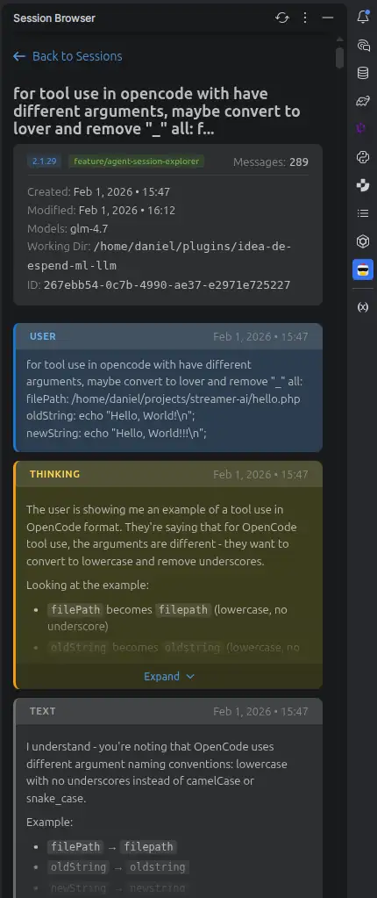
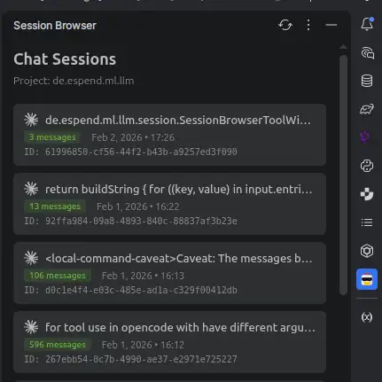
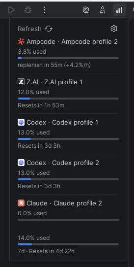
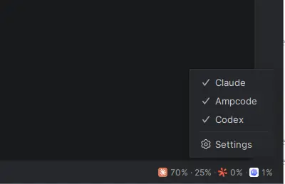

# AI Assistant Providers / Sessions for IntelliJ IDEA

[![zread](https://img.shields.io/badge/Ask_Zread-_.svg?style=flat&color=00b0aa&labelColor=000000&logo=data%3Aimage%2Fsvg%2Bxml%3Bbase64%2CPHN2ZyB3aWR0aD0iMTYiIGhlaWdodD0iMTYiIHZpZXdCb3g9IjAgMCAxNiAxNiIgZmlsbD0ibm9uZSIgeG1sbnM9Imh0dHA6Ly93d3cudzMub3JnLzIwMDAvc3ZnIj4KPHBhdGggZD0iTTQuOTYxNTYgMS42MDAxSDIuMjQxNTZDMS44ODgxIDEuNjAwMSAxLjYwMTU2IDEuODg2NjQgMS42MDE1NiAyLjI0MDFWNC45NjAxQzEuNjAxNTYgNS4zMTM1NiAxLjg4ODEgNS42MDAxIDIuMjQxNTYgNS42MDAxSDQuOTYxNTZDNS4zMTUwMiA1LjYwMDEgNS42MDE1NiA1LjMxMzU2IDUuNjAxNTYgNC45NjAxVjIuMjQwMUM1LjYwMTU2IDEuODg2NjQgNS4zMTUwMiAxLjYwMDEgNC45NjE1NiAxLjYwMDFaIiBmaWxsPSIjZmZmIi8%2BCjxwYXRoIGQ9Ik00Ljk2MTU2IDEwLjM5OTlIMi4yNDE1NkMxLjg4ODEgMTAuMzk5OSAxLjYwMTU2IDEwLjY4NjQgMS42MDE1NiAxMS4wMzk5VjEzLjc1OTlDMS42MDE1NiAxNC4xMTM0IDEuODg4MSAxNC4zOTk5IDIuMjQxNTYgMTQuMzk5OUg0Ljk2MTU2QzUuMzE1MDIgMTQuMzk5OSA1LjYwMTU2IDE0LjExMzQgNS42MDE1NiAxMy43NTk5VjExLjAzOTlDNS42MDE1NiAxMC42ODY0IDUuMzE1MDIgMTAuMzk5OSA0Ljk2MTU2IDEwLjM5OTlaIiBmaWxsPSIjZmZmIi8%2BCjxwYXRoIGQ9Ik0xMy43NTg0IDEuNjAwMUgxMS4wMzg0QzEwLjY4NSAxLjYwMDEgMTAuMzk4NCAxLjg4NjY0IDEwLjM5ODQgMi4yNDAxVjQuOTYwMUMxMC4zOTg0IDUuMzEzNTYgMTAuNjg1IDUuNjAwMSAxMS4wMzg0IDUuNjAwMUgxMy43NTg0QzE0LjExMTkgNS42MDAxIDE0LjM5ODQgNS4zMTM1NiAxNC4zOTg0IDQuOTYwMVYyLjI0MDFDMTQuMzk4NCAxLjg4NjY0IDE0LjExMTkgMS42MDAxIDEzLjc1ODQgMS42MDAxWiIgZmlsbD0iI2ZmZiIvPgo8cGF0aCBkPSJNNCAxMkwxMiA0TDQgMTJaIiBmaWxsPSIjZmZmIi8%2BCjxwYXRoIGQ9Ik00IDEyTDEyIDQiIHN0cm9rZT0iI2ZmZiIgc3Ryb2tlLXdpZHRoPSIxLjUiIHN0cm9rZS1saW5lY2FwPSJyb3VuZCIvPgo8L3N2Zz4K&logoColor=ffffff)](https://zread.ai/Haehnchen/idea-de-espend-ml-llm)

Browse and search chat sessions from external AI tools, expose conversations through MCP, monitor AI provider quotas from the toolbar and status bar, and view Tokscale usage statistics and RTK token savings.

| Key | Value |
|-----|-------|
| ID | `de.espend.ml.llm` |
| Releases | [GitHub Releases](https://github.com/Haehnchen/idea-de-espend-ml-llm/releases) |

Install the plugin manually using the ZIP from [GitHub Releases](https://github.com/Haehnchen/idea-de-espend-ml-llm/releases). See [Installation](#installation) for the steps.

## Features

### Provider Usage Toolbar & Status Bar

Monitor your AI provider quota usage across multiple accounts directly from the toolbar or status bar. Click the usage icon to see current usage percentages and reset times.

**Locations** (when configured):
- **Main toolbar** (right side) → Usage icon
- **Status bar** (bottom of IDE) → Usage widget

Configure accounts in **Settings → Tools → Account Usage Toolbar**.

| Provider | Quota Type | Credential Modes |
|----------|------------|------------------|
| **Claude** | 5-hour window + 7-day window | Auto (`~/.claude/.credentials.json`), Manual (access token), Web API (sessionKey) |
| **Codex** | Rate limit quota | Auto (`~/.codex/auth.json`), Manual (refresh token) |
| **Ollama** | Session window + Weekly window | `__Secure-session` cookie from ollama.com/settings |
| **Z.AI** | Token quota | API key |
| **Ampcode** | Free credits balance | Auto (`~/.local/share/amp/secrets.json`), Manual (API key) |
| **Junie** | Request quota | Auto (`~/.junie/token.json`), Manual (API key) |

### Session Browser

Browse and view chat sessions from external AI tools directly in the IDE.

Open the Session Browser from **Tools → AI Session Browser** or **View → Tool Windows → Session Browser**.

| Source          | Description |
|-----------------|-------------|
| **Claude Code** | Chat sessions from Claude Code CLI |
| **Codex CLI**   | Chat sessions from Codex CLI, including sessions created through JetBrains AI Assistant |
| **OpenCode**    | Chat sessions from OpenCode CLI |
| **Amp**         | Chat sessions from ampcode.com |
| **Junie**       | Chat sessions from Junie CLI (JetBrains) |
| **Droid**       | Chat sessions from Factory.ai CLI |
| **Kilo Code**   | Chat sessions from Kilo Code CLI |

### MCP Integration (IntelliJ Built-in MCP Server)

The plugin exposes AI session data via IntelliJ's built-in MCP server, allowing any MCP client (e.g. AI agents, CLI tools) to search and retrieve past coding sessions.

**Requirement**: The `com.intellij.mcpServer` plugin must be enabled in your IDE.

| Tool | Description |
|------|-------------|
| **`search_ai_sessions`** | Search across all AI sessions for a query string. Returns matching sessions with text snippets. |
| **`get_ai_session`** | Fetch the full conversation of a session by its ID. |

## Tools

Additional tools integrated into the plugin:

| Tool | Description |
|------|-------------|
| **RTK Savings** | Token savings statistics from RTK (Rust Token Killer) CLI. Shows yesterday, today, and 7-day totals in the Usage popup. |
| **Tokscale** | Token usage and cost statistics from Tokscale CLI. Shows weekly and monthly totals in the Usage popup. |

## Installation

1. Download the plugin ZIP from [GitHub Releases](https://github.com/Haehnchen/idea-de-espend-ml-llm/releases). Keep the ZIP file intact.
2. In IntelliJ IDEA, open **Settings → Plugins**.
3. Click the gear icon and select **Install Plugin from Disk…**.
4. Select the downloaded ZIP and restart the IDE if prompted.

To update the plugin, download the ZIP from a newer release and repeat these steps.

## Images

